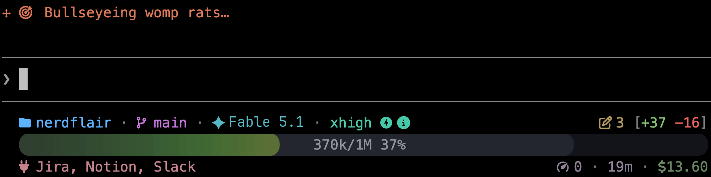
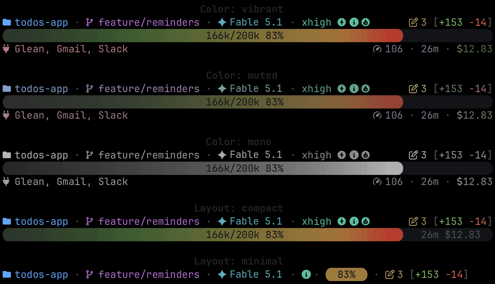
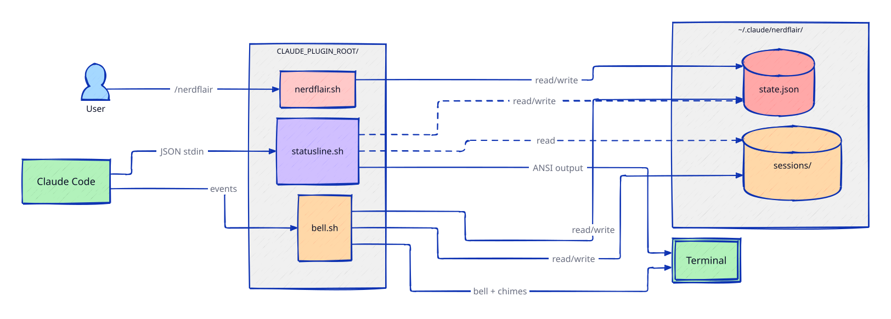

<p align="center">
  
</p>

<p align="center">
  <a href="LICENSE"></a>
  
  
  
</p>

<p align="center">
  <strong>A configurable bash statusline and audio/spinner pack for Claude Code</strong>
</p>



<details>
<summary><strong>Layout and color variations</strong></summary>



</details>


## Quick Start

```
/plugin marketplace add jcraigk/nerdflair
/plugin install nerdflair@jcraigk/nerdflair
/nerdflair install
```

Restart Claude Code after install for the changes to take effect.


## Hover panels

Hover a readout on the status line and a small card floats over the screen, saying what the number is and where it comes from. No row is reserved for it, and nothing is patched inside Claude Code, so a Claude Code update cannot break it.

`/nerdflair install` turns it on. It needs `python3` and **tmux**, and a new shell afterwards. A bare `claude` then starts under a small pty wrapper (`band/bridge/nfpty.py`) that watches the pointer on its way through and paints the card. To use it without the installer, run `band/hover/install.sh`; to remove it, `band/hover/install.sh uninstall`.

While a card is open, its readout on the status line is painted in the same highlight the band's own readouts get on hover (the readout's own card colour as the fill, dark bold text on it), and put back cell for cell when the card goes. It is read from the shadow screen and written to the terminal, nothing is injected. It follows the readout if the line shifts, goes with the card if a dialog covers the line, and without the shadow (`NFPTY_SHADOW=0`, or the shadow failing) there is no highlight, the card still works, and the reason is in `nfpty-error.log`.

How it stays out of the way:

- The shim at `~/.nerdflair/bin/claude` finds the real `claude` on `PATH` at every start. It wraps only a real terminal inside tmux, and runs plain `claude` for pipes, `-p`, `--version` and subcommands such as `mcp` or `plugin`. `NERDFLAIR_HOVER=0` turns it off for one run.
- Where a card sits is read from the screen on each hover, so it follows the status line when a figure changes width.
- If tmux's socket has been deleted (the server keeps running but every `tmux` command fails), `nf-tmux-heal` recreates it by signalling the running server. It never starts or kills one.
- `nf-tmux-watch` (a small user service the installer starts) notices the moment a tmux socket is deleted, logs every process that was running to `~/.local/state/nerdflair/tmux-watch.log`, and repairs it within a second. Five restarts in ten minutes and systemd stops trying, so it cannot loop.
- `mklayout.py --cards-check` runs the real renderer over the test payloads and fails if any readout has no card.

### Remote Control on the status line

The Remote Control (RC) state is a readout on the main status line, next to tmux and MCP health: a green `⬤ RC web` while a bridge is attached (the label is where it is drawing, else `on`), a grey `◯ RC off`, an amber `? RC unknown`. It has a hover card and the same background highlight as every other readout, in the state's colour. The Rust renderer and the bash twin draw it byte for byte alike.

Nothing in a renderer can ask Claude Code whether a bridge is attached, so the `nerdflair-band` plugin (`band/sync-local-plugin.sh` installs it) tells it. Every few seconds it runs `nerdflair-statusline --rc-sync <session id> <label>`, which writes one line into the private cache dir (0700, atomic, never through a symlink), as `rc-<session id>` (the id with anything outside `A-Za-z0-9_-` turned into `_` byte by byte and cut to 64 characters; when that changed anything, `-<cksum of the raw id>` is appended so `a/b` and `a_b` never share a file. Both renderers and the writer use the same rule; `--rc-name <id>` prints it for tests):

```
v1 on|off|unknown <since-epoch> <label>
```

It writes only when the state or label changed, or the file is over 30 s old, and never when the plugin can't tell the session id. Once a day the writer also deletes `rc-*` files over 7 days old (never a render, never `--json`). The renderer reads it and decides:

- no file: the plugin isn't loaded, nothing is shown and nothing is invented
- `on` and over 120 s old: the plugin stopped refreshing it, so amber unknown, logged once (`rc-stale`)
- a corrupt file (wrong shape, unknown state, a label outside letters, digits, space and `+._-`, or over 24 characters): amber unknown, logged once (`rc`)
- `--json` (the band's call) never writes or reads it

The band row itself (the plugin's tree above the prompt) is now off by default. Touch `~/.claude/nerdflair/band-debug` or start Claude Code with `NERDFLAIR_BAND_DEBUG=1` to draw it for debugging; `NERDFLAIR_BAND_DEBUG_FILE` moves the flag file (the tests use it). With the flag the band behaves exactly as before. A failing sync draws the band even without the flag, so the fault shows. The plugin keeps the record from the render hook and from a `session.start` timer, so it doesn't depend on the engine drawing a band that has nothing to show. `NERDFLAIR_RC_TIMER=0` turns that timer off (test-only, default on), so a live run can tell whether `ui.render` alone keeps the record. `tests/rc-sync.sh` and the `rc` cases in `tests/difftest.sh` and `tests/silent-failures.sh` cover it, and `mklayout.py`'s drift check holds the colours, glyphs and card lines of the plugin, `rust/src/rc.rs` and the hover card together.

### When something degrades, it says so

Nothing here fails silently. A fallback is allowed (hover must never stop you running `claude`), but every one leaves a line with the reason, once. If a card looks wrong or hover has stopped working, read these first:

| Log | Written by | What lands in it |
|---|---|---|
| `~/.local/state/nerdflair/nfpty-error.log` | the pty wrapper | the shadow screen failing to start or turning off, tmux not answering, a layout that could not be read, cards clipped or blanked, a hover bug (with traceback; hover is then off for that session), signals, a terminal left in raw mode |
| `~/.local/state/nerdflair/launcher.log` | the shim, `nf-tmux-heal`, the installer | the wrapper failing to start and claude launching plain instead, heal unable to act, python missing |
| `~/.local/state/nerdflair/tmux-watch.log` | `nf-tmux-watch` | each deleted socket, what was running, whether it was really healed |
| `~/.claude/nerdflair-errors.log` | the renderer (Rust and bash) | the ledger or `state.json` not writable, a corrupt state file, git or the MCP probe failing, a missing transcript, a bad payload, a panic, and a `cache-dir` line when the private cache directory is unusable (see below) |

Renderer caches (git, multi-repo branches, tmux session name, burn samples, repo cost, MCP health, the chime lock) live in one private per-user directory, never in `/tmp`: `$NERDFLAIR_CACHE_DIR`, else `$XDG_CACHE_HOME/nerdflair`, else `~/.cache/nerdflair`. It is created mode 0700 and checked on use: it must be a real directory (not a symlink), owned by you, with no group or other permission bits. If it is not (or `HOME` is empty and `NERDFLAIR_CACHE_DIR` is unset) the renderer skips its caches, renders normally and logs a `cache-dir` line with the reason once an hour. Without a cache the repo-cost ledger is not appended to (nothing could rate limit it), and the MCP probe and chime overlap lock are skipped. Both `NERDFLAIR_CACHE_DIR` and `XDG_CACHE_HOME` must be absolute paths (a relative one is rejected and logged). At the default location (`~/.cache/nerdflair` or `$XDG_CACHE_HOME/nerdflair`) a directory of yours that is too open (say 0755) is tightened to 0700 and the repair is logged. An explicit `NERDFLAIR_CACHE_DIR` is never narrowed behind your back: if it is open it is refused and the log says `chmod 700 <dir>`. A symlink, a directory owned by someone else, or one that cannot be created is refused with the reason, and a `recovered` line follows when it works again. With no cache directory the repo-cost rate limit falls back to the private stamp directory, and only if that is unusable too is the ledger append skipped (logged as `repocost-skipped`). Older versions kept these files as `/tmp/nerdflair-*`; those are ignored now and safe to delete (`rm -f /tmp/nerdflair-*`). While the cache directory is unusable the repo-cost rate limit markers live in the stamp directory (`~/.claude/.nerdflair-stamps/nerdflair-err-UID-repocost_*`); they stay after recovery, are tiny, and are safe to delete (names are cut at 100 characters, which real UUID session ids never reach). Tests point `NERDFLAIR_CACHE_DIR` at a temp dir. `tests/silent-failures.sh` counts forks in a private user+pid namespace; where those are unavailable it FAILS unless `NF_ALLOW_SKIP_NS=1` is set, in which case it skips that one check, says so in its last line and exits 77. Likewise it fails without `cargo` (needed for the Rust unit tests and `tests/log-sanitizers.sh`) unless `NF_ALLOW_SKIP_CARGO=1`.

Plan limits (`5h` / `7d`) are always drawn when there is something real to show. Claude Code sends each window only for Pro and Max, only after the session's first response, and drops a window once its `resets_at` passes, so either can be missing on its own. A window in the payload is drawn as is. If `5h` is missing but `7d` is present, the record's 5h is used while its reset is still ahead, else the 5h window lapsed with nothing used: a dim `5h 0%` with no countdown, and the block timer says `idle`. If both are missing, the last-known account-wide record (`limits-last` in the private cache dir, written at most once every 30 seconds from any payload that carries a window) fills in: a window whose recorded reset is still ahead shows its recorded percentage dim with its countdown, one whose reset has passed shows dim `0%`. With no record at all (API-key users) nothing is drawn and nothing is logged. Only the first line of the record is read, a reset more than 8 days ahead marks it corrupt, and percentages are clamped to 100. The read-merge-write is unlocked, so two sessions racing can clobber one window with a value at most one window stale; the next write after 30 seconds heals it. A corrupt or unreadable record is ignored and logged once an hour as `limits-last`. No number is ever invented. In a fresh session with cost still `$0.00` the bottom row now keeps every readout that has data (tmux name, token rate, API time, burn, block, repo cost), where it used to drop all but the chime, MCP health, limits and ETA.

`nerdflair-statusline --json` (the plugin band, which sends a made-up payload) never writes the per-session sample file, the usage ledger, the repo-cost stamps or `limits-last`, and never reads the sample file, so the band cannot distort the real line's token rate or ETA. `tests/json-isolation.sh` checks it. It does read the ledger and `limits-last` so the band still shows block and limits.

Each line is `time, what, why`. The renderer logs a given cause at most once an hour (except when the stamp directory and its marker are both unusable: then once per render, since nothing can rate limit), and says `recovered` once when it clears; the wrapper logs a given cause once per session, or once a minute with a count for events that can repeat. The installer and sync script also print the reason and exit non-zero on a real failure. The band itself shows a red `nerdflair-band: ...` line, or a `stale Ns` marker on old figures, when the renderer fails. `NFPTY_ERRLOG=path` redirects the wrapper's log.

Things that are normal are not logged: a closed window, tmux lock contention, a directory that is not a git repository, an unfinished escape sequence.


## Features

- **3 layout modes:** full (3 rows), compact (2 rows), minimal (1 row)
- **Context bar:** color shifts from green to red as context fills, with a compaction threshold marker
- **3 color palettes**: vibrant (full color), muted (desaturated), mono (grayscale)
- **Custom spinner verbs:** 150 themed thinking/working phrases
- **Terminal bell**: (tab indicator) on Notification, PermissionRequest, and Stop events
- **Audio chimes (macOS, Linux)**: 20 styles, configurable per-event, adjustable volume
- **Project folder display:** always shows the launch directory, not the current subdirectory Claude may have navigated to
- Git branch, files edited, and lines added/removed
- Model name with indicators for output style, reasoning effort, extended thinking, and fast mode
- Active MCP servers
- Session cost, API duration, and token throughput
- Chime style label (shown for the random style before any cost is incurred)


## Prerequisites

**`jq` is required.** The statusline parses Claude Code's session JSON with [jq](https://jqlang.github.io/jq/); without it the statusline exits and renders nothing.

```bash
brew install jq        # macOS
sudo apt install jq    # Debian/Ubuntu
```

**A Nerd Font is required.** The statusline uses [Nerd Font](https://www.nerdfonts.com/) glyphs for icons and Powerline caps. Without one installed, characters render as boxes.

Install via Homebrew or download from [nerdfonts.com](https://www.nerdfonts.com/):

```bash
brew install --cask font-jetbrains-mono-nerd-font
```

<details>
<summary><strong>Terminal font configuration</strong></summary>

Installing only puts the font files on disk; your terminal won't use it until you select it:

| Terminal | Where to set the font |
|----------|----------------------|
| **iTerm2** | Settings -> Profiles -> Text -> Font -> select "JetBrainsMono Nerd Font" |
| **Terminal.app** | Settings -> Profiles -> (your profile) -> Font -> Change -> select "JetBrainsMono Nerd Font" |
| **Warp** | Settings -> Appearance -> Terminal font -> select "JetBrainsMono Nerd Font" |
| **Ghostty** | Add `font-family = JetBrainsMono Nerd Font` to `~/.config/ghostty/config` |
| **VS Code terminal** | Settings -> search "terminal font" -> set Terminal > Integrated: Font Family to `JetBrainsMono Nerd Font` |

</details>


## Usage

Use the `/nerdflair` command to configure the statusline:

<details>
<summary><strong>Command reference</strong></summary>

| Command | Effect |
|---------|--------|
| `/nerdflair` | Show current settings and command reference |
| `/nerdflair install` | Install or upgrade (font check, settings.json config; preserves existing settings) |
| `/nerdflair uninstall` | Remove nerdflair from settings and clean up data |
| `/nerdflair info` | Show current settings without changing anything |
| `/nerdflair chime-events` | Show/toggle which events play chimes |
| `/nerdflair chime-session [style]` | Set chime style for this session only (plays preview) |
| `/nerdflair chime-style [style]` | Set or cycle global chime style (random, BalladPiano, ...) |
| `/nerdflair chime-volume [0-100]` | Set chime volume (0 = muted) |
| `/nerdflair color-palette [mode]` | Set or cycle palette (vibrant, muted, mono) |
| `/nerdflair layout [mode]` | Set or cycle layout (full, compact, minimal) |
| `/nerdflair spinner-verbs` | Toggle custom spinner verbs on/off |
| `/nerdflair terminal-bell` | Toggle terminal bell on/off (tab indicator) |
| `/nerdflair width [auto\|50-150]` | Set layout width |

</details>


## Cursor / VS Code Extension

A lightweight extension brings NerdFlair's audio chimes to Cursor (or VS Code). It reuses the same 20 chime styles from the Claude Code plugin.

### What's included

- **Random style per session** — one of 20 chime styles is chosen at random each time the editor opens
- **Audio chimes via [Cursor hooks](https://docs.cursor.com/agent/hooks)** — SessionStart, Stop, and SessionEnd sounds
- **Status bar** — shows the current style; click to cycle through all 20

### Install

Clone the repo and symlink the extension into your editor's extensions directory:

```bash
git clone https://github.com/jcraigk/nerdflair.git ~/nerdflair

# Cursor
ln -s ~/nerdflair/cursor-extension ~/.cursor/extensions/nerdflair-chimes

# VS Code (if using VS Code instead)
ln -s ~/nerdflair/cursor-extension ~/.vscode/extensions/nerdflair-chimes
```

Then add the hooks config at `~/.cursor/hooks.json` (adjust the path if you cloned elsewhere):

```json
{
  "version": 1,
  "hooks": {
    "sessionStart": [
      {
        "command": "bash ~/nerdflair/cursor-extension/play-chime.sh SessionStart"
      }
    ],
    "stop": [
      {
        "command": "bash ~/nerdflair/cursor-extension/play-chime.sh Stop"
      }
    ],
    "sessionEnd": [
      {
        "command": "bash ~/nerdflair/cursor-extension/play-chime.sh SessionEnd"
      }
    ]
  }
}
```

Restart the editor. You should hear a startup chime and see the style name in the status bar.

### Settings

Search "nerdflair" in Settings to configure:

| Setting | Default | Description |
|---------|---------|-------------|
| `nerdflair-chimes.volume` | `1.0` | Playback volume (0–1) |
| `nerdflair-chimes.audioDirectory` | auto-detect | Override path to `assets/audio` |

> **Note:** The extension requires `jq` and `afplay` (macOS) or `paplay` (Linux) for audio playback.


## How It Works (Claude Code)

Three bash scripts and one JSON state file.



- **Renderer** (`scripts/statusline.sh`) — Claude Code pipes session JSON on every refresh. Reads state, outputs ANSI-colored statusline.
- **Configurator** (`scripts/nerdflair.sh`) — Handles `/nerdflair` commands. Reads and writes the state file.
- **Hook Handler** (`hooks/bell.sh`) — Fired on Claude Code events. Sends terminal bell and plays audio chimes (macOS, Linux) based on user-defined config.

All settings persist in `~/.claude/nerdflair/state.json`. Per-session data (chime style) is stored as JSON in `~/.claude/nerdflair/sessions/` and cleaned up automatically.


## Update

```
/plugin update nerdflair
/nerdflair install
```

`/plugin update` pulls the latest version. `/nerdflair install` refreshes the statusline config while preserving your existing settings. Restart Claude Code after updating.


## Uninstall

```
/nerdflair uninstall
/plugin uninstall nerdflair
```

`/nerdflair uninstall` removes nerdflair's statusline, spinner verbs, and data from `~/.claude/`. `/plugin uninstall` removes the plugin itself. Restart Claude Code after uninstalling.
