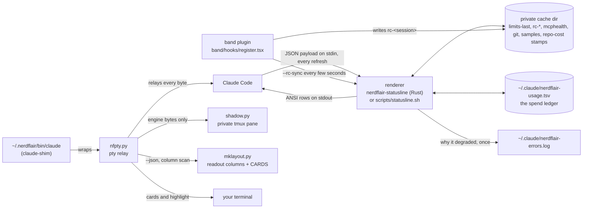

# How nerdflair is put together

This is the map I wish I'd had when I started on this fork. It says what runs where, why it runs there, and which test holds each piece in place. Read it top to bottom once and the rest of the repo stops being a maze.

The short version: Claude Code pipes a JSON payload into a renderer, the renderer prints up to three rows, and a handful of small files in a private cache dir carry what one render needs to know about the last. Everything else (the band plugin, the hover cards, the installers) exists to feed that loop or to draw on top of it without touching Claude Code.



## 1. The payload and the two renderers

Claude Code runs the `statusLine` command on each refresh and writes a JSON payload on its stdin: model, cost, context window, `rate_limits` (5h and 7d, Pro and Max only), session id, workspace. The renderer prints ANSI rows and exits. It never talks back to Claude Code and it never edits the screen.

There are two renderers and they have to agree byte for byte:

- `rust/src/main.rs` builds `nerdflair-statusline`, the one that's installed. It's about 2 ms a render where bash was about 54 ms (commit "Add a Rust implementation of the statusline").
- `scripts/statusline.sh` is the bash twin and the reference. Upstream nerdflair was bash, and the bash copy is still the easiest place to read what a readout means.

`tests/difftest.sh` runs both over every payload in `tests/payloads/` (307 of them, each a `.json` with an optional `.env`) and fails on any byte of difference. It runs each payload in private git fixtures, keeps the first attempt's diff, and fails the run when a payload renders differently on a retry (`UNSTABLE`). `tests/difftest-unstable-guard.sh` proves that last rule can fire.

A change to either renderer without the matching change in the other is a broken build, full stop. That's also why some things that would be easy in Rust (a column tracker, for one) live somewhere else instead.

`--json` is a second mode: the same segments with stable ids, for the band plugin. It reads the ledger and `limits-last` so the band still shows block and limits, and it never writes the sample file, the ledger, the repo-cost stamps or `limits-last` (`tests/json-isolation.sh`).

## 2. The private cache dir

All renderer caches live in one per-user directory (`rust/src/util.rs` around line 376): `$NERDFLAIR_CACHE_DIR`, else `$XDG_CACHE_HOME/nerdflair`, else `~/.cache/nerdflair`. Both variables must be absolute. It's created 0700 and checked on every use: a real directory, owned by you, no group or other bits. At the default location a too-open dir of yours gets tightened and the repair logged; an explicit `NERDFLAIR_CACHE_DIR` is never narrowed behind your back, it's refused with `chmod 700 <dir>` in the log. When the dir is unusable the renderer still renders, skips its caches and logs `cache-dir` once an hour. Older versions used `/tmp/nerdflair-*`; those files are ignored now.

| File | Format | Written | Lifetime |
|---|---|---|---|
| `limits-last` | `v1 <pct>:<reset> <pct>:<reset>`, `-` for a missing window | from any payload with a window, at most every 30 s (`main.rs` line 1549) | account-wide, overwritten in place. Only line 1 is read, a reset more than 8 days ahead marks it corrupt, pct is clamped to 100 |
| `rc-<slug>` | `v1 on\|off\|unknown <since-epoch> <label>` | by `--rc-sync` when the state or label changes, or the file is over 30 s old (`rust/src/rc.rs`) | read as amber unknown once over 120 s old; files over 7 days are deleted once a day, stamped by `nerdflair-rc-pruned` |
| `nerdflair-mcphealth-UID-<cksum of project dir>` | probe result for that project | by the probe job, under the shared `nerdflair-mcphealth-UID.lock` | fresh for `NERDFLAIR_MCP_HEALTH_TTL` (300 s); files untouched for 14 days are pruned once a day, stamped by `nerdflair-mcphealth-prune-UID` |
| `nerdflair-sample-UID-<session>` | `v2 <rate>` then lines of `<epoch> <used10> <api_ms>` | each render (never from `--json`) | per session; the ring behind token rate and the compaction ETA |
| `nerdflair-repocost-UID-<session>` | empty stamp | when a ledger row is appended | its age rate limits the append to one per `NERDFLAIR_REPO_COST_TTL` (60 s) |
| `nerdflair-repocost-total-UID-<repo>` | memo of the repo total | when the ledger is read for the total | reused until the next append is due |
| `nerdflair-git-<cksum>`, `nerdflair-multibranch-<cksum>` | git status and branch lines | on a stale read | `GIT_CACHE_TTL` (3 s, `main.rs` line 25) |
| `nerdflair-tmux-UID-<pane>` | tmux session name | on a stale read | 60 s |
| `nerdflair-chime-UID.lock` | lock | by the chime player in `scripts/lib.sh` (`NERDFLAIR_ALLOW_OVERLAP=1` skips it) | held for one chime, so several sessions finishing at once don't stack |

The slug rule for `rc-` names is shared by `rc_name` in `rust/src/rc.rs` and `_nf_rc_name` in `scripts/statusline.sh`: keep ASCII `[A-Za-z0-9_-]`, turn every other byte into `_`, cut at 64, and if that changed anything append `~<cksum of the raw id>`. `~` is outside the clean set, so `a/b` and `a_b` can't share a file. `--rc-name <id>` prints it for tests.

Two things sit outside the cache dir on purpose:

- **The ledger**, `~/.claude/nerdflair-usage.tsv` (`NERDFLAIR_REPO_COST_FILE` moves it). One row per append: `epoch<TAB>session<TAB>repo<TAB>cost`. Appenders take a shared lock on `<ledger>.lock`; compaction (read all, write temp, rename) takes the exclusive one, runs only when the file is over 2 MB and at most once an hour (stamp `<ledger>.compacted`), so a row can't be lost under it (`tests/ledger-concurrency.sh`). Burn and block read the last 1 MiB, widened once 16x when that doesn't reach back to the block start. The repo total reads at most the last 16 MiB and draws a `~` lower bound when cut. It outlives the cache dir because it's the only record of spend, and with no cache dir and no stamp dir the append is skipped and logged as `repocost-skipped`.
- **The stamps**, `~/.claude/.nerdflair-stamps/` (`rust/src/errlog.rs` line 45), named `nerdflair-err-UID-<cause>`. They're what makes "once an hour" true for the error log, and they carry the repo-cost rate limit while the cache dir is down. Tiny, safe to delete.

## 3. The band plugin

`band/hooks/register.tsx` is a Claude Code plugin that used to draw its own row above the prompt with the same readouts. The row is off now. One constant decides it, `BAND_ROW_ENABLED = false` at line 16, and a debug flag can turn it back on without a code change: touch `~/.claude/nerdflair/band-debug`, or start Claude Code with `NERDFLAIR_BAND_DEBUG=1`. The row draws when the constant is true or the flag is on. `tests/band-switch.sh` flips the constant in a temp copy and checks the suite notices.

Hidden, it still does the one job nothing else can. A renderer has no way to ask Claude Code whether a Remote Control bridge is attached, and only a child spawned fresh sees the current `CLAUDE_CODE_BRIDGE_SESSION_ID`. So the plugin runs `nerdflair-statusline --rc-sync <session id> <label>` (every `RC_SYNC_MS`, 2 s, at most), which writes the `rc-` record and prints `debug=1` or `debug=0` for the row switch. It does this from the render hook and from a `session.start` timer, because `ui.render` fires only on turn activity: measured live with the band hidden, it doesn't fire on keystrokes or while idle, so without the timer an idle session's record would go stale and read amber unknown after 120 s. `NERDFLAIR_RC_TIMER=0` turns the timer off and is for tests only.

If the plugin faults before it's ever written a record (no HOME, no session id, a failing first sync, an old binary with no `debug=` line), it opens the row with the error, because until then the main line shows nothing and a broken plugin would look like an uninstalled one. After one good sync, faults go to the debug log and the RC readout turns amber on its own.

## 4. The hover system

Hover a readout and a card floats over the screen saying what it is and where it comes from, while the readout itself lights up. No row is reserved and nothing inside Claude Code is touched.

### Why a pty and not an injector

Three routes were tried first and each one was closed by a measurement, written up at the top of `band/bridge/nfpty.py`. The engine clamps absolutely-positioned boxes to its live frame, so an in-engine card can't float. `LD_PRELOAD` sees nothing, since Bun issues its write syscalls itself. The Node inspector attaches fine, but the engine doesn't read the terminal through `process.stdin` (reads=0 under a burst of motion). The one place every byte has to pass is the pty, so that's where it lives. A Claude Code update can't break it, because it touches nothing inside Claude Code.

### The pieces

- **`band/hover/claude-shim`**, installed as `~/.nerdflair/bin/claude` ahead of the real one on `PATH`. It finds the real `claude` fresh on every start and wraps it in `nfpty.py` only when that can work: a real tty on all three fds, inside tmux, not `-p`/`--version`/`--help`, not a subcommand like `mcp` or `plugin`, not already wrapped (`NFPTY`), not opted out (`NERDFLAIR_HOVER=0`). Anything else execs plain `claude`. It also sets `CLAUDE_CODE_TMUX_TRUECOLOR`, since Claude Code clamps to 256 colours whenever `$TMUX` is set.
- **`band/bridge/nfpty.py`** holds the pty master and relays bytes both ways unchanged. Claude Code turns on mouse modes 1000, 1002, 1003 and 1006 itself, so the terminal already reports plain motion; an SGR report with button 35 (motion, nothing held) is a hover (`HOVER_BTN`). Reports are read in passing and forwarded, so the engine keeps its own hover behaviour. `TERMINAL_NOISE` keeps focus-in, device replies and cursor reports from counting as typing.
- **`band/bridge/shadow.py`** is the terminal emulator I declined to write. It's a second, private tmux server with one pane running `cat` on a fifo, fed every byte the engine writes and none of ours. tmux parses that into the engine's own screen with no card on it. The real pane can't tell you what's under a card, and this can.
- **`band/bridge/mklayout.py`** finds where each readout sits. The renderer's `--json` knows segment texts and ids but not columns, and teaching it columns would mean touching code held byte-identical to the bash twin. So the columns come from the rendered row: gaps of 2 or 3+ spaces split the justified halves (`GAP`), `" · "` splits segments, and a row counts as ours only if it carries a Nerd Font glyph from the private-use area (`NERD`). Claude Code's own hint line uses ordinary symbols, so it's excluded by construction.
- **`CARDS`** in `mklayout.py` (line 56) gives each readout an id, ordered text patterns (first match wins, specific ones first), a title, body lines and an accent colour. It mirrors `CARDS` in `register.tsx`. Drift guards hold them together (`band_drift`, `text_drift`, `rc_drift` against `rc.rs`), and `mklayout.py --cards-check` runs the real renderer over the payloads three times in a temp HOME and fails if any readout has no card or its lit span differs from its own span, at 250, 120, 80 and 60 columns.
- **`band/bridge/panel.py`** paints the card and its glints, a bright shine that runs the border (`TRAIL` 14 cells, `FPS` 28, `REST` 26 frames between sweeps). Everything terminal-specific goes through one `write` callable, so `hoverdemo.py` and `nfpty.py` paint the same card.

### The title-sequence sync

tmux and `cat` are asynchronous, so a capture could miss the last bytes fed. Before reading, `shadow.py` appends a title sequence carrying a fresh number and polls the pane title until it shows that number. tmux sets the title only after it's parsed everything before it, so a matching title means the screen is current. Every tmux call has a 0.5 s timeout, the backlog is capped at `MAX_BACKLOG` (4 MiB), and any failure turns the shadow off. Callers then read the live pane, the old behaviour, and the highlight is dropped (the card still works, the reason goes to `nfpty-error.log`). The worst case is the old card, never a stuck session.

### One hover, start to finish

```mermaid
sequenceDiagram
  participant T as terminal
  participant P as nfpty.py
  participant E as claude (engine)
  participant S as shadow tmux
  T->>P: ESC[<35;col;rowM (motion, no button)
  P->>E: forwarded unchanged
  P->>S: title sync, capture rows
  S-->>P: engine's own screen
  P->>P: mklayout scan, hit test, short linger
  P->>S: save cells under the card
  P->>T: paint card + highlight (at a sequence boundary)
  E->>P: more output while the card is up
  P->>T: relayed, highlight marked dirty, repaint at most every 0.5 s
  T->>P: pointer leaves (HIDE_AFTER 0.25 s), focus-out, resize or alt-screen
  P->>S: title sync
  P->>T: restore saved cells, cell for cell
  P->>S: re-check once engine output settles
  P->>T: repaint from the shadow if anything changed
```

The layout is re-read from the shadow on each hover, so a figure changing width moves the hit area with it. A card is painted only at escape-sequence boundaries of the engine's stream, never inside one, with cursor and SGR saved and restored around every write. With no pointer report for `WATCHDOG` (4 s) the card comes down, since a terminal sends nothing when the pointer leaves the window. When the last report was on the card it waits `WATCHDOG_ON_CARD` (20 s) instead, because you're probably reading it.

### The highlight and its cost

While a card is up its readout is repainted with the card's accent as the fill (`48;2;R;G;B`) and dark bold text (`INK`, `38;2;31;41;55`), the same look the band gives its readouts on hover, and put back cell for cell when the card goes. A first version filled with `#1f2937`, which disappeared against the terminal background.

The rule is simple: any engine output while a highlight is up marks it dirty. Repaints are spaced by `max(REFRESH, 15 x last blocking time)`, capped at 2 s, with `REFRESH = 0.5` (`nfpty.py` line 362). A cycle is about four tmux spawns, so that's 8 a second at most, and the e2e asserts 10. No card and a quiet engine means zero work. A screen tracker (`RowTracker`) was tried and deleted after 10 review findings in favour of this.

### Alt-screen

A switch to or from the alternate screen (`?1049`, `?1047`, `?47`, matched by `ALT_SCREEN`, and `ALT_PARTIAL` treating a read that ends partway into one as a switch, at the cost of one erased card) takes the card and the highlight down, because whatever they covered just stopped being on screen. So does a dialog drawn over the status line: hover regions don't survive something painted over them.

### Why tmux is required

Cards paint over the real screen, so the real screen can't say what's beneath. The shadow is that borrowed knowledge, and it's a tmux server, so the shim only wraps inside tmux. Two helpers keep tmux itself healthy: `nf-tmux-heal` recreates a deleted socket by signalling the running server, and `nf-tmux-watch` (a user service) notices the deletion, logs what was running and repairs it within a second. Neither ever starts or kills a server.

## 5. Logs, and the "say why once" rule

A fallback is fine. Hover must never stop you running `claude`, and a broken cache must never blank the status line. A silent fallback isn't fine. Every one leaves a line saying why, once.

- `~/.claude/nerdflair-errors.log`, from both renderers through `rust/src/errlog.rs` and the bash `_nf_err`: a given cause once an hour (by its stamp), plus one `recovered` line when it clears.
- `~/.local/state/nerdflair/nfpty-error.log`, from the bridge through `band/bridge/nflog.py`: `note_once` once per session, `note_rate` once a minute with a count for things that repeat. `NFPTY_ERRLOG` moves it.
- `~/.local/state/nerdflair/launcher.log`, from the shim, heal and the installer, once an hour per reason.
- `~/.local/state/nerdflair/tmux-watch.log`, from `nf-tmux-watch`.

Normal things aren't logged: a closed window, tmux lock contention, a directory that isn't a git repo, an unfinished escape sequence. No log line may carry terminal control bytes either; five copies of that filter exist and `tests/log-sanitizers.sh` keeps them in step.

## 6. Tests and gates

Every test runs against a temp `HOME` and `NERDFLAIR_CACHE_DIR`, never the real ones.

| Gate | What it holds |
|---|---|
| `cargo test --release` (in `rust/`) | Rust unit tests |
| `tests/difftest.sh` | Rust and bash byte-identical over 307 payloads |
| `tests/silent-failures.sh` | one failure class per case in both renderers, exactly one log line, same stdout; forks counted in a private namespace |
| `tests/burn-block-golden.sh`, `tests/golden-mutation.sh` | burn and block arithmetic against hand-computed answers, and proof the golden can fail |
| `tests/ledger-concurrency.sh`, `ledger-big.sh`, `ledger-widen.sh` | no row lost under compaction, bounded reads on a huge ledger, the one 16x widen |
| `tests/loadtest.sh` | the status line can't melt the machine again (the 2026-10-08 incident) |
| `tests/transcript-tail.sh` | the gauge reads a transcript's tail, never the whole file |
| `tests/limits-costless.sh` | 5h and 7d always drawn when there's something real, `limits-last` rules |
| `tests/rc-sync.sh` | `--rc-sync` writes, the slug rule, staleness, prune |
| `tests/json-isolation.sh` | `--json` never writes per-session or account state |
| `tests/row3-gap.sh`, `placeholders.sh`, `mcp-cap.sh`, `mcp-per-project.sh`, `git-head-fallback.sh`, `empty-home.sh` | one readout rule each |
| `tests/plugin-sync.sh` | the published plugin's version changes with its content |
| `tests/band-switch.sh` | the `BAND_ROW_ENABLED` constant really switches the row |
| `tests/install-rc.sh` | `band/hover/install.sh` in a throwaway HOME: the rc blocks go in and come out |
| `tests/launcher-logging.sh`, `tests/log-sanitizers.sh` | the shell layer logs every absorbed failure; the five sanitizers agree |
| `tests/bridge-selfchecks.sh` | the in-file selfchecks of `nfpty.py`, `shadow.py`, `mklayout.py`, `panel.py` |
| `tests/nfpty-exit.sh`, `tmux-heal.sh`, `tmux-watch.sh` | nfpty exits the way the child did; heal and watch on private sockets |
| `band/bridge/hover-*-e2e.py` | real hover runs against a stand-in engine on private tmux servers (`hover-e2e.py` uses the ambient tmux, so it's run by hand) |
| `claude plugin test band` | the plugin's own tests (`band/hooks/register.test.ts`) |

## 7. Install and update

- `scripts/build-rust.sh` builds the binary and installs it to `~/.local/bin/nerdflair-statusline`, outside `target/` so `cargo clean` can't blank the status line. Then it runs `band/sync-local-plugin.sh --check`, since a code deploy is exactly when a stale plugin goes unnoticed.
- `band/hover/install.sh` links `~/.nerdflair/hover` to `band/bridge`, copies the shim and the tmux helpers into `~/.nerdflair/bin/`, and adds one marked block at the end of `~/.bashrc`, `~/.zshrc` and the one login file bash reads, putting that dir first on `PATH`. `uninstall` takes all of it back out, and `/nerdflair install` calls it for you.
- `band/sync-local-plugin.sh` publishes `band/` as the user-level plugin `nerdflair-band@local`. It's a copy, because a symlinked source resolves outside the marketplace and the plugin fails with "Path escapes plugin directory". After any change under `band/`, run it, then `/reload-plugins`.

The plugin version is a content stamp. `claude plugin update` keys its cache on the version, so with `plugin.json` fixed at `0.1.0` an update after a code change was a silent no-op: on 2026-10-19 a copy from 9 October was still drawing a bug fixed on the 19th. The published copy now carries `0.1.0-<8 hex of its own content>`, so a change to what ships gives Claude Code a new version to fetch and no change gives the same one. `--stamp` prints what this checkout would publish and `--check` says whether the published copy matches.
